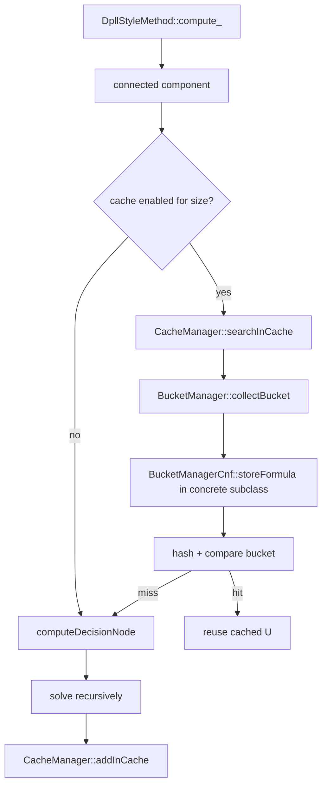

# AI Generated Documentation

**Disclaimer**: This documentation was generated using AI and may contain inaccuracies or omissions. It should always be viewed alongside the source code it documents.

# Cachin and DPLL Intensive Explanation

This document explains the cache-and-bucket layer used by `d4` and shows how it is connected to `DpllStyleMethod<T, U>`. The focus is not only on what each class stores, but on why the class exists, what role it plays in the solving pipeline, and how the objects collaborate during recursive search.

The three central classes covered here are:

* `BucketManager`
* `BucketManagerCnf`
* `CacheManager`

The DPLL-style controller that uses them is:

* `DpllStyleMethod<T, U>`

The short version is:

* `BucketManager` knows how to serialize a connected component into a cacheable bucket.
* `BucketManagerCnf` specializes that idea for CNF formulas and knows how to collect relevant clauses.
* `CacheManager` hashes bucket representations, looks them up, stores them, and manages cache memory pressure.
* `DpllStyleMethod` asks the cache for each connected component before recursing, so repeated subproblems are reused instead of recomputed.

---

## 1. Why this subsystem exists

`DpllStyleMethod` is a recursive solver/compilation engine. Its main cost is not the SAT call itself, but the repeated exploration of the same structural subproblems. When a connected component of the formula appears again later, the solver would normally rebuild and resolve it from scratch.

The cache subsystem prevents that.

Instead of caching only a numeric answer, `d4` caches a *serialized description* of the active formula fragment. That description is built from the current connected component, converted into a compact bucket, hashed, and compared against stored buckets. If the same bucket already exists, the cached semantic result can be reused immediately.

That design has three advantages:

1. The cache key is structural, not tied to a single recursion path.
2. The bucket encoding can be optimized for CNF formulas.
3. The cache can be selectively enabled only when the connected component is small enough to be worth hashing.

---

## 2. Execution picture

The relationship between the classes is easiest to see as a pipeline.



The important point is that the cache is not consulted at the very top of the search tree. It is consulted *after* the formula has been decomposed into connected components. That means the cache works on already-separated subproblems, which makes the bucket representation smaller and the lookup more effective.

---

## 3. `BucketManager`: the abstract bucket front end

File: `src/caching/BucketManager.hpp`

### Purpose

`BucketManager<T>` is the abstract front end for all bucket encoders. It does not know CNF-specific syntax by itself. Its job is to provide a uniform interface for turning a connected component into a serialized bucket that can be hashed by the cache.

You can think of it as the bridge between:

* the solver's current structural state, and
* the cache's need for a byte-level representation.

### Main attributes

* `BucketAllocator *m_bucketAllocator;` - low-level memory allocator used to store serialized bucket data.
* `CachedBucket<T> m_bucket;` - reusable bucket object used as scratch space when serializing a component.
* `CacheManager<T> *m_cache;` - back pointer to the cache system that owns this bucket manager.

These are the core responsibilities:

* `m_bucketAllocator` ensures bucket serialization is efficient and avoids fragmentation.
* `m_bucket` is the temporary carrier for the serialized formula fragment.
* `m_cache` lets the bucket manager participate in cache-driven memory reuse.

### Factory function: `makeBucketManager`

`makeBucketManager(config, cache, s, out)` is the constructor selector for bucket encoders.

It chooses the concrete implementation based on configuration values:

* `cache_clause_representation == "clause"` -> `BucketManagerCnfCl<T>`
* `cache_clause_representation == "sym"` -> `BucketManagerCnfSym<T>`
* `cache_clause_representation == "index"` -> `BucketManagerCnfIndex<T>`
* `cache_clause_representation == "combi"` -> `BucketManagerCnfCombi<T>`

It also converts `cache_store_strategy` into a `ModeStore` value:

* `not-binary` -> `NB`
* `not-touched` -> `NT`
* anything else -> `ALL`

This factory is important because the cache layer is not tied to a single encoding strategy. The same `CacheManager` can be paired with different bucket encodings depending on the configuration.

### Main function: `collectBucket`

`collectBucket(std::vector<Var> &component)` is the common entry point used by the cache.

Its job is simple:

1. Call the virtual `storeFormula(component, m_bucket)`.
2. Return a pointer to the internal reusable bucket.

The key detail is that `storeFormula` is virtual. `BucketManager` does not itself know how to serialize a CNF component; it only knows that one of its concrete subclasses will fill the bucket.

### Other utilities

* `nbOctetToEncodeInt(unsigned int v)` tells how many bytes are needed to encode a non-negative integer.
* `usedMemory()` reports allocator memory consumption.
* `getComsumedMemory()` indicates whether the allocator had to go beyond the initial page.
* `reinitComsumedMemory()` resets that pressure flag.
* `releaseMemory(char *m, unsigned size)` returns a serialized block to the allocator.
* `remainingMemory()` exposes how much allocator capacity is still available.

### What this class is really doing

`BucketManager` is not a cache and not a solver. It is a format adapter. It decides how a current connected component is converted into bytes, and it hides the fact that the actual conversion is strategy-specific.

That separation matters because the cache code only cares about:

* getting a stable byte representation,
* hashing that representation,
* and comparing it against stored entries.

It does not care whether the bytes came from a clause-oriented, symbolic, indexed, or mixed encoding.

---

## 4. `BucketManagerCnf`: the CNF-specialized base encoder

File: `src/caching/cnf/BucketManagerCnf.hpp`

### Purpose

`BucketManagerCnf<T>` is the CNF-specific base class for all concrete bucket encoders. It knows how the current problem is represented as a CNF formula and which clauses belong to a given component.

It is the class that makes the abstract `BucketManager` useful for CNF solving.

### Main attributes

* `SpecManagerCnf &m_specManager;` - access to CNF-specific clause metadata and occurrence information.
* `ModeStore m_modeStore;` - controls which clauses are stored in the bucket.
* `unsigned m_nbClauseCnf;` - total number of clauses in the formula.
* `unsigned m_nbVarCnf;` - total number of variables in the formula.
* `unsigned m_maxSizeClause;` - maximum clause length.
* `std::vector<bool> m_varInComponent;` - temporary mark array for component membership.
* `std::vector<int> m_idxClauses;` - temporary list of active clause indices.

These members are the minimal CNF state needed to build a compact bucket.

### Constructor

The constructor stores the spec manager, cache pointer, allocator pointer, mode, and CNF size information. It also initializes the bucket allocator.

That initialization is not incidental: the bucket manager expects the allocator to be ready before any serialization begins because bucket storage happens on demand during cache lookups.

### Clause filtering: `isKeptClause`

`isKeptClause(int idx)` decides whether a clause should be represented in the bucket.

The policy depends on `m_modeStore`:

* `NT` keeps only clauses with `getNbUnsat(idx)` true.
* `NB` keeps only clauses whose size is greater than 2.
* `ALL` keeps every clause.

This is where the cache representation becomes policy-driven. The solver does not always need every clause stored in the bucket. Some strategies intentionally drop clauses that are considered less useful for the chosen caching mode.

### Active clause collection: `collectIdActiveClauses`

This method gathers the clause indices that belong to the current component and survive the store policy.

It works in two phases:

1. Ask `SpecManagerCnf` for the current clauses related to the component.
2. Remove clauses rejected by `isKeptClause`.

The result is a compact list of clause IDs that actually matter for serialization.

### What this class contributes

`BucketManagerCnf` does not yet choose a final byte layout. Instead, it prepares the CNF data that a concrete subclass will serialize.

That makes it a base class for CNF bucket encodings and a home for shared logic such as:

* clause filtering,
* component clause collection,
* CNF size bookkeeping,
* and allocator initialization.

Concrete subclasses such as `BucketManagerCnfCl`, `BucketManagerCnfSym`, `BucketManagerCnfIndex`, and `BucketManagerCnfCombi` then decide the final encoding layout.

---

## 5. `CacheManager`: lookup, insertion, and cache policy

File: `src/caching/CacheManager.hpp`

### Purpose

`CacheManager<T>` is the central controller for cache storage and retrieval. It owns the bucket manager, owns the cache-cleaning policy, and exposes the high-level operations used by `DpllStyleMethod`.

The class answers the practical question:

*Given a connected component, is its subproblem already known? If not, how do we record it?*

### Main attributes

* `bool verb;` - verbosity flag.
* `unsigned long m_nbEntry;` - number of cache entries.
* `unsigned long m_nbPositiveHit;` - successful hits.
* `unsigned long m_nbNegativeHit;` - unsuccessful hits.
* `unsigned minAffectedHitCache;` - cache impact metric.
* `double sumAffectedHitCache;` - accumulated cache impact metric.
* `unsigned m_nbInitVar;` - initial variable count.
* `unsigned m_nbRemoveEntry;` - number of removed entries.
* `unsigned long int m_nbCreationBucket;` - number of created buckets.
* `unsigned long int m_sumDataSize;` - total serialized data size.
* `unsigned int m_limitVarCached;` - maximum component size eligible for caching.
* `HashString hashMethod;` - hash function used on bucket bytes.
* `BucketManager<T> *m_bucketManager;` - responsible for bucket serialization.
* `CacheCleaningManager<T> *m_cacheCleaningManager;` - responsible for eviction/reduction policies.

These members show that `CacheManager` is not a thin map wrapper. It is a policy hub: it knows when caching is allowed, how the key is built, when memory pressure requires cleanup, and how to keep statistics.

### Factory function: `makeCacheManager`

`makeCacheManager(config, nbVar, specs, out)` chooses the concrete cache implementation.

Currently it can create:

* `CacheNoCollision<T>`
* `CacheList<T>`

The selection depends on `config.cache_method`.

### Core policy: `isActivated`

`isActivated(unsigned nbVar)` returns whether a component of that size is allowed to use the cache.

This is the gate used by `DpllStyleMethod` before any bucket serialization happens.

So the cache is not merely enabled or disabled globally. It can be activated only for components small enough to be worth caching.

### Core operation: `searchInCache`

This is the most important method in the class.

It performs the full lookup workflow:

1. If the bucket allocator has consumed too much memory, ask the cleaning manager to reduce the cache and reset the consumption flag.
2. Ask the bucket manager to collect the current component into a serialized bucket.
3. Compute a hash value for the bucket.
4. Ask the cache implementation whether a matching bucket already exists.
5. Update cache-hit statistics.
6. If the bucket is not found, return a `TmpEntry<T>` marked as undefined and keep the newly created bucket.
7. If the bucket is found, release the memory used by the temporary bucket and return a defined `TmpEntry<T>` pointing to the cached one.

This method is the handoff point between the solver's structural logic and the cache's storage logic.

### `addInCache`

`addInCache(TmpEntry<T> &cb, T val)` inserts the computed result into the cache.

It uses the bucket and hash value stored in the temporary entry. This is why the lookup function returns both the bucket and the hash: the same data can be reused directly for insertion when the recursive computation finishes.

### Other important functions

* `usedMemory()` delegates memory accounting to the bucket manager.
* `releaseMemory(CachedBucket<T> &formulaBucket)` returns a bucket allocation to the allocator.
* `printCacheInformation(std::ostream &out)` prints hit statistics and cleaning statistics.
* `setInfoFormula(unsigned mVar)` stores formula-wide size information used by cache policy heuristics.

### What this class is really doing

`CacheManager` is the policy and bookkeeping layer for memoization. It sits above the bucket serializer and above the concrete cache container. That position lets it enforce both structural rules and memory rules.

In practice, `DpllStyleMethod` uses `CacheManager` as the only cache interface it needs to know about.

---

## 6. How the three classes fit together

The three classes form a clean responsibility chain:

### `BucketManager`

Defines the abstract bucket interface and owns the reusable bucket/allocator plumbing.

### `BucketManagerCnf`

Provides the CNF-specific shared logic for selecting clauses and preparing component data.

### `CacheManager`

Uses a `BucketManager` to build a bucket, hashes the bucket, searches the cache, and stores results.

This means the cache system has a layered design:

* the solver asks for a lookup,
* the cache manager builds a bucket,
* the bucket manager serializes the component,
* and the concrete cache container decides whether the bucket already exists.

---

## 7. How `DpllStyleMethod` uses them

File: `src/methods/DpllStyleMethod.hpp`

`DpllStyleMethod` is the user of this subsystem. It does not serialize buckets directly, and it does not manipulate the cache container directly. It only coordinates the solving flow and delegates cache-specific work to `CacheManager`.

### 7.1 Construction time

In the constructor, `DpllStyleMethod` creates the cache manager with:

```cpp
m_cache = CacheManager<U>::makeCacheManager(config, m_problem->getNbVar(),
                                            m_specs, m_out);
```

This is the moment where the cache subsystem is attached to the solver.

The `CacheManager` constructor then creates:

* a `CacheCleaningManager`,
* a `BucketManager` through its factory,
* and the concrete cache structure requested by the configuration.

That means one constructor call in `DpllStyleMethod` activates the whole caching stack.

### 7.2 Component-level cache check

Inside `compute_`, the solver splits the current formula into connected components.

For each component it evaluates:

```cpp
bool cacheActivated = cacheIsActivated(connected);
```

`cacheIsActivated` is a simple gate:

* it returns `false` if caching is globally disabled,
* otherwise it asks `m_cache->isActivated(connected.size())`.

This ensures the cache is only used when the component size is within the configured threshold.

### 7.3 Search before recursion

If the cache is active, `DpllStyleMethod` calls:

```cpp
TmpEntry<U> cb = cacheActivated ? m_cache->searchInCache(connected)
                                : NULL_CACHE_ENTRY;
```

This is the main integration point.

What happens next depends on the `TmpEntry`:

* `cb.defined == true` means the bucket already existed, so the solver reuses `cb.getValue()`.
* `cb.defined == false` means the component has not been seen before, so `DpllStyleMethod` continues with `computeDecisionNode`.

### 7.4 Cache hit path

On a cache hit, the solver does not recurse.

It only copies the stored value into the current component slot:

```cpp
tab[cp] = cb.getValue();
```

This is the real payoff of the bucket system. The connected component is recognized structurally, and the already computed semantic result is reused.

### 7.5 Cache miss path

On a cache miss, `DpllStyleMethod` computes the component by branching:

```cpp
tab[cp] = computeDecisionNode(connected, out);
```

After the subproblem is solved, the result is inserted back into the cache:

```cpp
if (cacheActivated)
  m_cache->addInCache(cb, tab[cp]);
```

This two-step pattern is essential:

1. lookup first,
2. compute only if needed,
3. insert the computed result for future reuse.

### 7.6 Why `searchInCache` is called at the component level

The solver only caches after connected-component decomposition because the component boundary is the natural independence boundary of the formula.

That gives two benefits:

* smaller bucket encodings, because unrelated parts of the formula are not included,
* stronger reuse, because the same subcomponent can recur under different higher-level branches.

### 7.7 Interaction with projected mode

`DpllStyleMethod` also uses the projected-variable bookkeeping while splitting the formula. That matters because the cache should only reuse components in a way that preserves the projection semantics.

The solver tracks decision variables, priority variables, and projected variables separately. The cache sits on top of that logic and memoizes only the component structure that remains relevant after those filters are applied.

### 7.8 What `DpllStyleMethod` does not do

`DpllStyleMethod` does not:

* manually serialize a component,
* manually hash the bucket,
* manually compare cached bucket contents,
* or manually manage cache eviction.

All of that is delegated to `CacheManager` and the bucket classes.

That separation keeps the recursive solver focused on search and leaves representation details to the cache layer.

---

## 8. Detailed responsibility map

### `BucketManager`

* owns the common bucket plumbing,
* chooses the concrete bucket representation strategy,
* exposes `collectBucket` and memory helpers,
* provides the abstract serialization hook `storeFormula`.

### `BucketManagerCnf`

* knows about CNF clauses and variables,
* filters clauses according to storage mode,
* collects active clause indices for a component,
* prepares CNF-specific data for subclasses.

### `CacheManager`

* controls cache lookup and insertion,
* hashes bucket data,
* delegates serialization to the bucket manager,
* tracks statistics,
* triggers cache reduction when allocator pressure grows.

### `DpllStyleMethod`

* decomposes the formula into connected components,
* asks the cache whether a component is already known,
* recurses only on cache misses,
* and combines results through the operation manager.

---

## 9. Practical mental model

If you want a simple mental model of the full system, use this one:

1. `DpllStyleMethod` finds an independent subproblem.
2. `CacheManager` asks `BucketManager` to turn that subproblem into a canonical bucket.
3. `BucketManagerCnf` helps the concrete serializer decide which clauses matter.
4. The cache hashes the bucket and checks whether the same structure was solved before.
5. If yes, the stored result is reused.
6. If not, `DpllStyleMethod` solves it recursively and stores the result for the next time.

This is the core reason the project can scale better than a plain recursive DPLL implementation: structural repetition is turned into memoization.

---

## 10. Summary

`BucketManager` is the abstract bucket-building interface, `BucketManagerCnf` is the CNF-specific preparation layer, and `CacheManager` is the lookup/insertion policy layer. `DpllStyleMethod` uses them as follows:

* it constructs the cache manager during initialization,
* checks whether a connected component is cache-eligible,
* probes the cache before recursing,
* and stores solved components back into the cache after a miss.

The net effect is that repeated connected components are solved once and reused many times, which reduces recomputation and makes the recursive solver much more efficient.