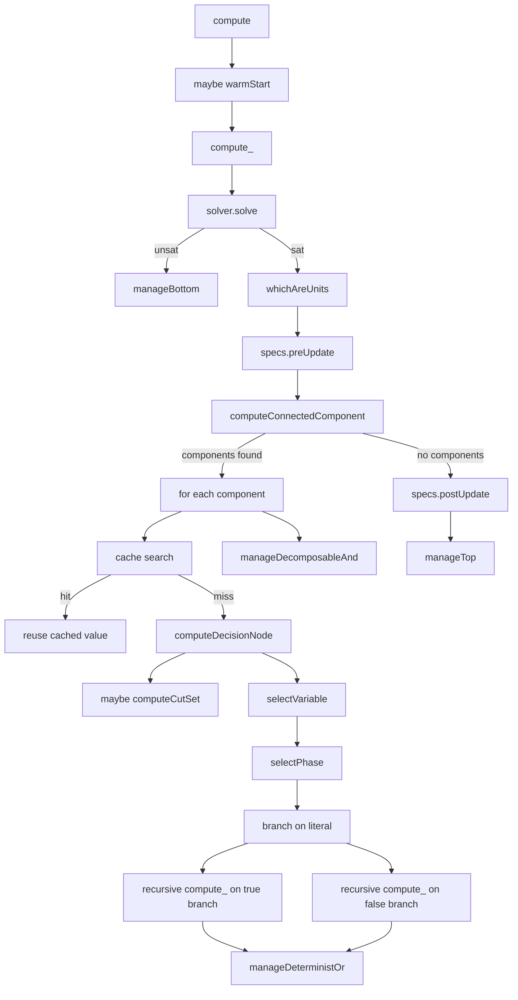

# AI Generated Documentation

**Disclaimer**: This documentation was generated using AI and may contain inaccuracies or omissions. It should always be viewed alongside the source code it documents.

# DpllStyleMethod Detailed Explanation

This document explains the `d4::DpllStyleMethod<T, U>` class from `src/methods/DpllStyleMethod.hpp` with a strong focus on `compute`. The explanation is recursive on purpose: when `compute` calls another method, that method is also explained, including the role of the class that owns it and the data it exchanges with the caller.

The class is the main DPLL-style compiler/solver loop used by the project. It drives SAT solving, component decomposition, caching, branching, and the final algebraic operation that turns search-tree events into either model counts or a decision-DNNF structure.

## 1. What this class does

`DpllStyleMethod<T, U>` is a template controller that performs recursive search on top of a SAT solver. It is responsible for:

1. Starting from the current formula and the current assumptions.
2. Asking the SAT solver whether the current branch is inconsistent.
3. Extracting unit literals from the solver state.
4. Asking the specification manager to propagate those units into the formula state.
5. Splitting the remaining problem into independent connected components.
6. Reusing cached results for components that were already solved.
7. Selecting a branching variable and a branching polarity when decomposition is not enough.
8. Recursing on both truth branches of the selected variable.
9. Combining the sub-results with an operation manager that knows whether the goal is counting, d-DNNF construction, or another supported result type.

The type parameter `T` is the final semantic result type returned to the user, while `U` is the internal recursive representation used by the operation manager. In counting mode, `T` and `U` are both usually numeric. In d-DNNF mode, `U` is a node identifier type and `T` is still the final counting type used by `count`.

## 2. Main collaborators

The class does not solve anything by itself. It coordinates a set of collaborators:

* `WrapperSolver` handles SAT solving and assumption management.
* `SpecManager` tracks the formula-specific state, including assigned literals, connected components, and projected variables.
* `ScoringMethod` chooses the next branching variable.
* `PhaseHeuristic` chooses the branching polarity for that variable.
* `PartitioningHeuristic` optionally creates a priority cut set to influence branching order.
* `CacheManager<U>` stores and retrieves solved connected components.
* `Operation<T, U>` maps recursive tree events to the final semantic object.

The object also keeps a few local arrays and counters for debugging, logging, and cache statistics.

## 3. Important fields

The most important members are:

* `m_problem`: the current problem instance.
* `m_solver`: the SAT wrapper.
* `m_specs`: the specification manager.
* `m_hVar`: the variable scoring/selection heuristic.
* `m_hPhase`: the polarity heuristic.
* `m_hCutSet`: the partitioning heuristic.
* `m_cache`: the component cache.
* `m_operation`: the algebra used to build the output object.
* `m_isProjectedMode`: tells whether only a selected subset of variables is decision-relevant.
* `m_isDecisionVariable`: marks which variables may still be branched on.
* `m_currentPrioritySet`: temporary priority markers created by the partitioner.
* `m_stampVar` and `m_stampIdx`: a fast marking array used for set intersection.

The logging counters are not just cosmetic: they are used to decide when to print headers and intermediate statistics, and they provide the end-of-run summary.

## 4. Construction and destruction

### Constructor

The constructor wires the complete solving stack together.

1. It copies the formatting state of the output stream into `m_out` so every nested subsystem prints consistently.
2. It creates the SAT wrapper via `WrapperSolver::makeWrapperSolver`.
3. It stores the panic flag from `LastBreathPreproc`, then configures solver conflicts and model extraction.
4. It creates the specification manager via `SpecManager::makeSpecManager`.
5. It creates the variable scoring heuristic and polarity heuristic from the configuration.
6. It marks decision variables. If the problem is projected, only selected variables are treated as decision variables.
7. It chooses the partitioning heuristic. In projected mode it uses the no-op partitioner; otherwise it uses a formula-aware partitioner.
8. It creates the cache manager.
9. It initializes timers and statistics.
10. It creates the operation manager through `Operation<T, U>::makeOperationManager`.

The constructor is important because it defines the entire behavior of the recursive search: a different configuration can replace the scoring method, polarity heuristic, partitioner, cache policy, or operation semantics without changing the recursive control flow.

### Destructor

The destructor deletes every owned collaborator. This is a classic ownership boundary: the method manager owns the objects it creates and is responsible for releasing them in reverse of construction.

## 5. Local helper methods in the class

### `expelNoDecisionVar`

This method filters a vector of variables in place.

* If the solver is not in projected mode, it does nothing.
* Otherwise it keeps only variables that are marked as decision variables in the provided boolean map.

This matters after connected-component decomposition. Some variables may remain in the component bookkeeping even though they are not decision-relevant. In projected mode those variables must be removed before recursion continues.

### `expelNoDecisionLit`

This is the literal version of the previous helper.

* It keeps only literals whose variable is a decision variable.
* It is applied to unit literals before the function returns a top result for a tautological component.

The literal form is required because unit propagation can produce forced assignments on variables that should not appear in the projected output.

### `computePrioritySubSet`

This helper computes the intersection of two sets of variables: the current connected component and a set of priority variables.

How it works:

1. It clears the output vector `currPriority`.
2. It increments `m_stampIdx` to create a fresh logical timestamp.
3. It stamps every variable from `connected` into `m_stampVar`.
4. It scans the priority variables and keeps only those that are stamped in the current component and are not already assigned.

The implementation uses stamping instead of repeated nested searches because that gives linear behavior in the size of the two lists rather than quadratic behavior.

### `showInter`, `separator`, `showHeader`, `showRun`, `printFinalStats`

These methods only handle output, but they help interpret the search state.

* `showHeader` prints the column labels for the live progress table.
* `showInter` prints one line of live statistics.
* `showRun` decides when to show the header and when to show an intermediate line, based on the call counter and mask constants.
* `separator` prints a visual divider.
* `printFinalStats` prints the final summary, then delegates to the cache and partitioning heuristic for their own statistics.

These methods do not change the solving logic, but they reveal the recursive solver's progress and are useful when reasoning about performance and decomposition frequency.

### `initAssumption`

This helper resets the solver to a clean assumption state.

1. It restarts the SAT solver.
2. It removes every currently stored assumption.
3. It installs the new assumption list.

This method is used by `count` because assumption-based counting must begin from an exact solver state. Any leftover assumption from a previous query would corrupt the result.

### `cacheIsActivated`

This helper is a small policy gate.

* If caching is globally disabled, it returns `false`.
* Otherwise it delegates to `m_cache->isActivated(connected.size())`.

The cache is therefore not purely global: it can be active only for connected components small enough to satisfy the cache size policy.

## 6. The recursive core: `compute_`

`compute_` is the main recursive engine. It is the first method that performs semantic work after the public `compute` wrapper decides whether the whole run should stop immediately.

### Signature and data flow

It receives:

* `setOfVar`: the variables still relevant for the current subproblem.
* `unitsLit`: the vector that will collect unit literals found at this level.
* `freeVariable`: variables that are no longer present in the formula because every clause that mentioned them became satisfied.
* `out`: the logging stream.

It returns a value of type `U`, which is the internal recursive result object managed by `Operation<T, U>`.

### Step-by-step behavior

#### 6.1 Logging and call counting

The method begins by printing intermediate status and incrementing `m_nbCallCall`.

This counter is important because it controls periodic logging, and the printed statistics are aligned with the logical recursion depth and call frequency.

#### 6.2 SAT consistency check

The first semantic test is:

```cpp
if (!m_solver->solve(setOfVar)) return m_operation->manageBottom();
```

This means the current branch is immediately inconsistent under the current solver state and the current variable scope.

The solver call is the absolute cheapest discriminating check in the whole recursion: if it returns false, the entire subproblem collapses to bottom and no component analysis or branching is needed.

The operation manager then turns that logical contradiction into the correct internal bottom object for the chosen output semantics.

#### 6.3 Extract unit literals

If the branch is satisfiable, the solver reports all forced literals by calling `whichAreUnits(setOfVar, unitsLit)`.

This does not just say that a variable is forced. It collects the actual literals and stores them in `unitsLit` so later phases can:

* update the specification manager state,
* preserve these forced assignments in the resulting object,
* and account for them when computing weights or annotations.

#### 6.4 Update the specification manager

`m_specs->preUpdate(unitsLit)` tells the specification layer that these units have been discovered before recursion continues.

The spec manager is responsible for propagating those facts into its own internal model of the formula. In practical terms, this is where the formula state is synchronized with the solver's latest deduction.

#### 6.5 Build connected components

The next major call is:

```cpp
int nbComponent = m_specs->computeConnectedComponent(varConnected, setOfVar, freeVariable);
```

This is one of the key structural optimizations in the whole class.

The method partitions the still-relevant variables into independent connected components. At the same time it may add variables to `freeVariable`, meaning those variables disappeared from the active formula because every clause that mentioned them is already satisfied.

If the problem splits into independent components, the recursion can solve each part separately and combine the results with a decomposable AND.

#### 6.6 Filter non-decision free variables

`expelNoDecisionVar(freeVariable, m_isDecisionVariable)` removes projected-out variables from the set of free variables.

This is necessary only in projected mode. In that mode, variables not selected for counting or compilation should not survive into the output structure as if they were decision variables.

#### 6.7 Component-by-component recursion

If `nbComponent` is nonzero, the method iterates over each component.

For each connected component:

1. It checks whether caching is enabled for that component size.
2. It searches the cache using the component's variable list.
3. If the cache hits, it reuses the stored value directly.
4. If the cache misses, it recurses with `computeDecisionNode(connected, out)`.
5. After a miss is solved, it adds the result back to the cache.

This is the place where the algorithm avoids recomputing equivalent subproblems. The cache probe returns a `TmpEntry<U>`, which records:

* the extracted bucket data,
* the computed hash,
* and whether the bucket already existed in the cache.

If the cache hit is positive, the subproblem result is reused exactly. If not, the recursive branch is solved from scratch and then cached for future reuse.

#### 6.8 Combine independent sub-results

After all components are processed, `m_specs->postUpdate(unitsLit)` restores the spec-manager state and the method returns:

```cpp
return m_operation->manageDecomposableAnd(tab, nbComponent);
```

This is the semantic combination step. The meaning of decomposable AND depends on the operation manager:

* In counting mode, it multiplies the sub-results, because independent components contribute multiplicatively.
* In decision-DNNF mode, it creates an AND node whose children are the component results.

The `tab` array contains one result per independent component.

#### 6.9 Tautological case

If `nbComponent` is zero, the formula is a tautology after propagation and decomposition.

The method performs `m_specs->postUpdate(unitsLit)`, filters unit literals through `expelNoDecisionLit`, and returns `m_operation->createTop()`.

This means: the current branch imposes no further constraints on the remaining decision variables, so the result is a semantic top object.

### Why `compute_` is the core recursion

`compute_` is the place where the algorithm decides between three structural outcomes:

1. Unsatisfiable branch -> bottom.
2. Decomposable independent components -> recursive AND over components.
3. No component split -> delegate to a decision node.

That is the central DPLL control structure.

## 7. `computeDecisionNode`: branching recursion

When decomposition is not enough, `compute_` delegates to `computeDecisionNode`. This method is the second half of the recursion tree: it chooses a variable, branches on it, and combines the two child results with a deterministic OR.

### Step 1: detect current branching context

The method first scans the component to determine whether there is at least one undecided decision variable, and whether any of those variables is already marked as priority.

This distinction matters because the partitioning heuristic should not keep recomputing cut sets if the current branch already contains a priority variable.

### Step 2: maybe compute a cut set

If:

* there is at least one decision variable,
* there is no already-active priority variable,
* and the partitioning heuristic reports that it is ready,

then `computeCutSet` is called and the resulting variables are marked in `m_currentPrioritySet`.

The cut set is not a semantic answer by itself. It is a steering structure that biases the scoring heuristic toward a better branching order.

### Step 3: choose the next variable

The code calls:

```cpp
Var v = m_hVar->selectVariable(connected, *m_specs, m_currentPrioritySet);
```

This is the branching-variable heuristic.

The method sees the current connected component, the current formula state, and which variables are currently prioritized. It returns the variable that should be branched on next, or `var_Undef` if no suitable variable exists.

If no variable is available, the method unsets the temporary priority set and returns `m_operation->manageTop(connected)`.

### Step 4: choose polarity

Once a variable is selected, the method calls:

```cpp
Lit l = Lit::makeLit(v, m_hPhase->selectPhase(v));
```

`selectPhase` decides whether the first branch should assign the variable true or false.

This polarity decision is not arbitrary. In this code base it can come from different heuristics:

* `PhaseHeuristicTrue` always prefers true unless reversed.
* `PhaseHeuristicFalse` always prefers false unless reversed.
* `PhaseHeuristicPolarity` asks the SAT solver's polarity manager.
* `PhaseHeuristicOccurrence` uses occurrence information from the spec manager.

The exact class depends on the configuration, but the contract is always the same: return a boolean phase for `Var v`.

### Step 5: first branch

The method pushes the chosen literal as an assumption and recursively evaluates the `true` branch:

```cpp
m_solver->pushAssumption(l);
b[0].d = compute_(connected, b[0].unitLits, b[0].freeVars, out);
m_solver->popAssumption();
```

This is a classic DPLL branch step, but with persistent solver state instead of rebuilding the formula from scratch.

The recursive call returns a full internal result `b[0].d`, plus the side-channel data `unitLits` and `freeVars` needed by the operation manager.

### Step 6: second branch

The second branch is handled carefully because the solver may already know the opposite literal from propagation.

The code checks:

* if `l` is already in the assumption, then the opposite branch is impossible and becomes bottom,
* else if `~l` is already in the assumption, it can recurse directly without pushing again,
* otherwise it pushes `~l`, recurses, and then pops it.

This avoids redundant SAT work and preserves the invariant that the solver state always matches the current path in the recursion tree.

### Step 7: clear temporary priority marks

`unsetCurrentPriority(cutSet)` restores the priority bitmap before returning.

This is essential: the cut set is only local to the current decision node. Leaving the marks on would leak heuristic state into sibling branches.

### Step 8: combine both children

The method returns:

```cpp
return m_operation->manageDeterministOr(b, 2);
```

This is the semantic OR node of the recursion. Again, its exact meaning depends on the output type:

* In counting mode, the two branch contributions are weighted and added.
* In decision-DNNF mode, the operation manager creates a deterministic OR node from the two child branches.

## 8. Public entry points

### `compute`

This is the public wrapper around the recursive engine.

Its first job is to decide whether the whole run can stop immediately:

* If the problem is already unsatisfiable, it returns bottom.
* If warm start is enabled, panic mode is off, and `m_solver->warmStart(...)` fails, it also returns bottom.

Only if the solver is in a viable state does it create the top-level `DataBranch<U>`, call `compute_`, and then wrap the result with `m_operation->manageBranch(b)`.

The important detail here is that `compute` is not just a simple wrapper. It inserts the warm-start optimization, which can prune the entire search before recursion begins.

### `count`

`count` answers a conditioned counting query.

1. It installs the assumption list with `initAssumption`.
2. It identifies assumptions that are not part of the current variable set and stores them in `shadowUnits`.
3. It pre-updates the spec manager with those shadow units.
4. It calls `compute(setOfVar, out, false)` to prevent warm-start from resetting the assumption state.
5. It post-updates the spec manager.
6. It asks the operation manager to convert the internal result into a final count.

The extra `shadowUnits` handling is important because assumptions can mention variables not present in the recursion scope, and those literals still need to be reflected in the formula state.

### `run`

`run` creates the full variable list from `1` to `m_specs->getNbVariable()`, calls `compute`, prints final statistics, and lets the operation manager output the final result format.

### `run_and_return`

This method is like `run`, but it only returns the internal result and does not print final output.

## 9. The recursive collaborators called by `compute`

This section explains the methods that `compute` and `computeDecisionNode` rely on.

### 9.1 `WrapperSolver`

`WrapperSolver` is an abstract SAT-solver facade. The class uses these members from it:

* `solve(setOfVar)`: checks whether the current branch is satisfiable under the current assumptions and the current variable scope.
* `whichAreUnits(component, units)`: extracts implied unit literals after propagation.
* `warmStart(iteration, sizeQuery, setOfVar, out)`: prepares a solver state that is more favorable to the current query pattern.
* `pushAssumption(l)` and `popAssumption()`: extend and shrink the current branch path.
* `isInAssumption(l)` and `isInAssumption(v)`: test whether a literal or variable already has a fixed value in the current branch.
* `restart()`, `setAssumption(assums)`, and `getAssumption()`: reset and rebuild the solver's assumption stack.
* `setNeedModel(true)`: asks the solver to keep a model when the branch is satisfiable, because later steps need model information for branching and/or output.

The concrete wrapper is created by a factory, so the exact solver backend can change, but the contract remains the same.

### 9.2 `SpecManager`

`SpecManager` is the stateful view of the formula. In this recursion it provides:

* `preUpdate(unitsLit)`: incorporate newly derived unit literals before the next structural analysis.
* `postUpdate(unitsLit)`: roll the state forward or backward after the recursive step is finished.
* `computeConnectedComponent(varConnected, setOfVar, freeVariable)`: split the active formula into independent components and report newly free variables.
* `varIsAssigned(v)`: test whether a variable is already fixed by the current formula state.
* `getNbVariable()`: used to build the initial scope list.
* `getNbSelectedVar()` and `getSelectedVar()`: used in the constructor to determine projected mode and decision-variable membership.

The `SpecManager` abstraction is the link between the SAT view and the structural decomposition view. Without it, `compute_` would be only a plain branch-and-bound procedure.

### 9.3 `CacheManager<U>`

The cache is component-based. It does not cache arbitrary solver states; it caches the formula induced by a connected component.

Methods used here:

* `isActivated(connected.size())`: decides whether this component size is worth caching.
* `searchInCache(connected)`: extracts a stable bucket for the current component and checks whether that bucket already exists.
* `addInCache(cb, value)`: inserts the solved value after a miss.
* `getNbPositiveHit()`, `getNbNegativeHit()`, and `usedMemory()`: used for status output.
* `printCacheInformation(out)`: used in the final statistics block.

The search call is subtle: it can allocate a bucket for the formula representation, compute its hash, and then discard the temporary bucket if the cache already contains an equivalent one.

### 9.4 `ScoringMethod`

`ScoringMethod` is the branching variable selector.

The most relevant method is `selectVariable(connected, *m_specs, m_currentPrioritySet)`.

Conceptually the method:

1. Filters variables that are already assigned.
2. Ignores variables that are not decision variables.
3. Honors priority variables when present.
4. Computes a score for each candidate.
5. Returns the best candidate according to the selected heuristic.

The concrete scoring strategy is created by the factory and can vary by configuration. Typical implementations in this code base include VSIDS-like and occurrence-based variants.

The scoring class also exposes `decay()` and `postProcess(v)`, which are heuristic maintenance hooks. They matter because some scoring heuristics need to adjust scores after each branch or periodically decay all scores to avoid stale history.

### 9.5 `PhaseHeuristic`

`PhaseHeuristic` decides the polarity for the chosen branching variable.

The important call is `selectPhase(v)`, which returns a boolean phase for the literal created by `Lit::makeLit(v, phase)`.

The concrete implementation is chosen by the factory. The main variants in the repository are:

* `PhaseHeuristicTrue`: returns the phase that corresponds to true, unless the heuristic is reversed.
* `PhaseHeuristicFalse`: returns the phase that corresponds to false, unless reversed.
* `PhaseHeuristicPolarity`: queries the solver's polarity manager.
* `PhaseHeuristicOccurrence`: bases the choice on occurrence information from the specification manager.

The polarity choice does not change correctness, but it can strongly change the shape of the recursion tree.

### 9.6 `PartitioningHeuristic`

`PartitioningHeuristic` is a heuristic steering layer that tries to isolate a useful cut set.

Its role in `computeDecisionNode` is:

* `isReady(connected)`: decide whether a partitioning attempt is worthwhile for the current component.
* `computeCutSet(connected, cutSet)`: produce a set of priority variables.

The exact implementation again depends on the factory. Some variants are essentially no-op, while others use hypergraph or static partitioning logic.

The output of the partitioner is not a final semantic result. It only influences the branching order by marking some variables as priority.

### 9.7 `Operation<T, U>`

`Operation` is the semantic backend that interprets recursion results.

The methods used by `DpllStyleMethod` are:

* `manageBottom()`: build the semantic result for an inconsistent branch.
* `manageTop(component)`: build the semantic result for a tautological component.
* `manageBranch(b)`: convert the top-level recursive result into the final root object.
* `manageDeterministOr(children, size)`: combine two decision branches.
* `manageDecomposableAnd(children, size)`: combine independent connected components.
* `manageResult(result, config, out)`: print or export the final result.
* `count(result)`: extract a numeric count from the internal object.

The repository contains at least two important concrete operations:

* `CountingOperation<T>`: multiplies and adds numeric weights, producing a model count.
* `DecisionDNNFOperation<T, U>`: creates and manages a decision-DNNF structure.

#### `CountingOperation`

This implementation treats recursion semantically as weighted counting.

* `manageDeterministOr` multiplies each child result by the weight contributed by its units and free variables, then adds the two branches.
* `manageDecomposableAnd` multiplies all independent component results.
* `manageBottom` returns zero.
* `manageTop` returns one.
* `manageBranch` multiplies the branch result by its local weight contribution.
* `manageResult` prints the final count in either competition or classic format.

The key idea is that the recursive tree is not merely a search tree. It is also a symbolic factorization of the counting problem.

#### `DecisionDNNFOperation`

This implementation stores the recursive tree as a node graph.

* `createTop` and `createBottom` create the terminal nodes.
* `manageDeterministOr` builds a deterministic OR node from two branches.
* `manageDecomposableAnd` builds an AND node from independent sub-results.
* `manageBottom` and `manageTop` convert terminal cases to node IDs.
* `manageBranch` builds a unary node that remembers one recursive branch and its side conditions.
* `manageResult` can dump the compiled structure or answer query commands against it.
* `count` traverses the final graph to compute the model count.

This means the same recursion engine can be reused either to count models directly or to materialize a compiled representation for later querying.

### 9.8 `DataBranch<U>` and `TmpEntry<U>`

These two small helpers are worth understanding because they are passed around repeatedly.

#### `DataBranch<U>`

This object stores the output of a recursive branch.

* `d` is the recursive semantic value.
* `unitLits` is the set of unit literals collected while solving that branch.
* `freeVars` is the list of variables that became free during propagation.

It is used by `manageBranch` and `manageDeterministOr` because the final semantics depends not only on the recursive child value but also on the literals and variables discovered along the path.

#### `TmpEntry<U>`

This is the cache probe result.

* `e` stores the cached bucket or the temporary bucket.
* `hashValue` stores the computed hash.
* `defined` tells whether the cache already contained the component.

When `defined` is true, the caller can reuse the cached value with `getValue()`.

## 10. The recursion as a flow

The entire execution can be summarized as:



The important point is that the recursion alternates between two control layers:

* structural decomposition into independent components,
* and variable branching when decomposition is not enough.

## 11. Practical interpretation of the recursion

The algorithm is best understood as a layered reduction pipeline:

1. SAT consistency check.
2. Propagation and unit extraction.
3. Structural decomposition.
4. Memoization by component shape.
5. Heuristic branching.
6. Algebraic combination of results.

Every recursive call preserves the solver state through assumptions. That is why the solver wrapper is central: it provides a cheap path-specific state machine instead of forcing the code to rebuild the formula at every step.

## 12. What changes the behavior most

If you want to reason about the solver's behavior, these are the highest-impact switches:

* The `Operation` implementation determines whether the recursion builds counts or a graph.
* The `ScoringMethod` determines the branching order.
* The `PhaseHeuristic` determines the branch polarity.
* The `PartitioningHeuristic` determines whether priority cut sets are used.
* The `CacheManager` determines how many repeated connected components are reused.
* The `SpecManager` determines how components are extracted and how formula state is synchronized.

## 13. Short summary

`DpllStyleMethod` is the recursion controller. `compute` is its public entry point. `compute_` performs the solve/decompose/recurse cycle. `computeDecisionNode` performs the branch/recurse/combine cycle. Everything else in the class either prepares state, maintains local priority and projection bookkeeping, or prints statistics.

The design is intentionally modular: each major step of the recursion is delegated to another class with a narrow responsibility. That is what makes the recursive explanation important, because the meaning of `compute` is only visible when all of its collaborators are understood together.