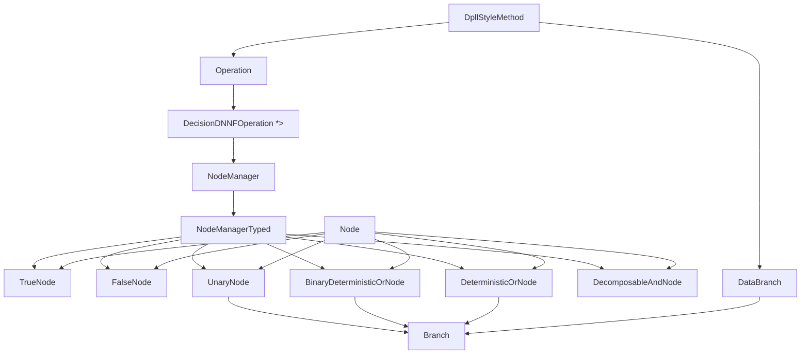

# AI Generated Documentation

**Disclaimer**: This documentation was generated using AI and may contain inaccuracies or omissions. It should always be viewed alongside the source code it documents.

# NNF and dDNNF Class Family Detailed Explanation

This document explains the classes in `src/methods/nnf/` together with `src/methods/DataBranch.hpp` and `src/methods/DecisionDNNFOperation.hpp`. The goal is to describe not only what each class stores, but also how the classes cooperate to build the decision-DNNF produced by `DpllStyleMethod`.

The most important idea is that the DPLL recursion does not directly build a tree of strings or clauses. Instead, it produces a structured graph of NNF nodes. The node family encodes the semantic result of each recursive step:

* contradictions become `FalseNode`
* tautologies become `TrueNode`
* a single constrained branch becomes `UnaryNode`
* a branching decision becomes `BinaryDeterministicOrNode` or `DeterministicOrNode`
* independent components become `DecomposableAndNode`

The `DecisionDNNFOperation` class is the bridge between the generic DPLL recursion and the concrete dDNNF node objects.

## 1. Class Map

The graph above should be read as a semantic chain:

1. `DpllStyleMethod` performs recursive SAT-based decomposition.
2. It calls an `Operation<T, U>` implementation.
3. In dDNNF mode that implementation is `DecisionDNNFOperation`.
4. `DecisionDNNFOperation` allocates and combines NNF nodes via `NodeManager`.
5. `NodeManagerTyped` creates the actual node objects in page-backed memory.

## 2. Shared Concepts

### 2.1 `TypeNode`

`TypeNode` is the runtime tag stored in `Node<T>::header.typeNode`. It tells the dispatcher which concrete node type a pointer really refers to.

The values are:

* `TypeIteNode` for `BinaryDeterministicOrNode`
* `TypeDetOrNode` for `DeterministicOrNode`
* `TypeUnaryNode` for `UnaryNode`
* `TypeDecAndNode` for `DecomposableAndNode`
* `TypeTrueNode` for `TrueNode`
* `TypeFalseNode` for `FalseNode`

This tag is what makes the `NodeManager` dispatch tables work. Each traversal method stores a function pointer array indexed by `header.typeNode`.

### 2.2 `header.stamp`

Every node stores a `stamp` field in the header. The code increments a global traversal stamp before each full traversal and compares it to the node stamp.

This avoids expensive full resets of the graph. Instead of clearing a visited flag on every node, the traversal just changes the meaning of the current stamp value.

### 2.3 `T` and `U`

These classes are heavily templated because the project supports two very different modes:

* counting mode, where the recursive result is a numeric type
* compilation mode, where the recursive result is a node pointer

In `DecisionDNNFOperation<T, Node<T> *>`, `T` is the model-counting type and `U` is the node pointer type returned by the compiler.

## 3. `Node<T>`

**Location:** `src/methods/nnf/Node.hpp`

### Role

`Node<T>` is the minimal base class for all NNF nodes. It does not contain formula data, children, or model counts. It only stores the common header used by every derived node.

### Members

#### `header.typeNode`

Stores the runtime class tag described above.

#### `header.stamp`

Stores the last traversal stamp that visited this node.

### Why the base class is so small

The derived classes use different storage layouts:

* some have one child, others have many children
* some store literals, others do not
* some store a variable-sized inline payload

The base class therefore only provides the common tag and traversal metadata.

## 4. `DataBranch<T>`

**Location:** `src/methods/DataBranch.hpp`

### Role

`DataBranch<T>` is a transport object used between the DPLL recursion layer and the output operation layer.

It represents one branch of the search tree together with the extra information needed to preserve semantics when building the final result.

### Members

#### `T d`

The compiled object for the branch.

* In counting mode, this is a numeric result.
* In dDNNF mode, this is usually a `Node<T> *`.

#### `std::vector<Lit> unitLits`

The unit literals that are currently forced for this branch.

These literals are preserved in the output structure because they represent concrete constraints discovered by propagation.

#### `std::vector<Var> freeVars`

Variables that have become free for this branch.

These variables are no longer constrained by the active subproblem. They matter for counting, because every free variable contributes multiplicatively, but they do not need an explicit node in the dDNNF structure.

### Semantic relation to `Branch<T, U>`

`DataBranch<T>` is the external, generic carrier used by `DpllStyleMethod` and `Operation<T, U>`.
`Branch<T, U>` is the internal branch representation embedded inside the concrete node classes.

`DataBranch` says: "here is a child result plus the literals and variables attached to it." `Branch` stores the same information in a compact inline layout inside the final graph node.

## 5. `Branch<T, U>`

**Location:** `src/methods/nnf/Branch.hpp`

### Role

`Branch<T, U>` stores the payload for one outgoing edge of a node:

* the child node pointer `d`
* the number of attached unit literals `nbUnits`
* the number of attached free variables `nbFree`

It also provides the logic that interprets this payload during counting, satisfiability checking, and NNF printing.

### Members

#### `Node<T> *d`

The child node reached by taking this branch.

#### `U nbUnits`

Number of attached unit literals in the inline payload.

#### `U nbFree`

Number of free variables in the inline payload.

### Private helper: `isUnsatLit(ValueVar value, U l)`

This helper checks whether a stored literal `l` is incompatible with the current variable assignment.

The literal encoding uses the low bit as the sign bit:

* `l & 1 == 0` means positive literal
* `l & 1 == 1` means negative literal

The helper returns `true` only when the current assignment makes the literal impossible.

### `computeNbModels(...)`

This method computes the weighted model count of a branch.

Parameters:

* `func`: dispatch table for recursive node counting
* `data`: inline payload storage containing literals and free variables
* `fixedValue`: current assignment state for each variable
* `problem`: access to literal and variable weights
* `globalStamp`: traversal stamp for memoization

Behavior:

1. Check every unit literal.
2. If one literal contradicts the current assignment, return `0`.
3. Multiply the current branch weight by the weight of each unit literal.
4. Recursively compute the count of the child node `d`.
5. Multiply by the contribution of each free variable.

The important semantic point is that unit literals constrain the branch, while free variables only change the multiplicative weight.

### `isSAT(...)`

This is the satisfiability-only version of the same traversal.

* It checks unit literals for contradictions.
* If the literals are compatible, it recurses into the child node.

The method returns whether the branch can still be satisfied under the current partial assignment.

### `printNNF(...)`

This method prints the child edge in NNF format.

It first asks the child node to print itself and then emits a line with:

* the parent node identifier
* the child node identifier
* every unit literal attached to the branch
* the terminating `0`

This is the key mechanism that turns an abstract branch into a concrete dDNNF edge label.

## 6. Terminal Nodes

### 6.1 `TrueNode<T>`

**Location:** `src/methods/nnf/TrueNode.hpp`

#### Role

Represents the constant truth node.

In model counting, it contributes multiplicative identity `1`.
In satisfiability checking, it is always satisfiable.

#### Members

* `T nbModels`: memoized traversal result and printed node identifier

#### Key methods

* `computeNbModels(...)` returns `1`
* `isSAT(...)` returns `true`
* `printNNF(...)` prints `t <id> 0`

### 6.2 `FalseNode<T>`

**Location:** `src/methods/nnf/FalseNode.hpp`

#### Role

Represents the constant contradiction node.

In model counting, it contributes `0`.
In satisfiability checking, it is always unsatisfiable.

#### Key methods

* `computeNbModels(...)` returns `0`
* `isSAT(...)` returns `false`
* `printNNF(...)` prints `f <id> 0`

### Semantic relation between the terminal nodes

These nodes are the leaves of the compiled structure. They are the base cases that terminate recursion when the search discovers a branch that is either completely satisfied or impossible.

## 7. `UnaryNode<T, U>`

**Location:** `src/methods/nnf/UnaryNode.hpp`

### Role

`UnaryNode` is the node used when one branch has a child node but also needs to preserve a local branch payload.

It is the compact wrapper for the situation:

* there is a single semantic child `d`
* there are unit literals that must remain attached
* there may be free variables that contribute only to counting

### Members

#### `T nbModels`

Memoized count or cached printed identifier.

#### `Branch<T, U> b`

The branch information associated with the unary node.

#### `U data[0]`

Inline payload storage immediately following the object in memory.

The constructor writes first all unit literals, then all free variables into this flexible tail.

### Why a unary node exists

The solver often reaches a subproblem that has only one meaningful continuation after simplification.

Rather than create a binary or n-ary OR with a single child, the code stores a unary wrapper. This keeps the representation compact while still preserving the branch annotations.

### Constructor semantics

The constructor copies the child pointer and the payload sizes from a `DataBranch<Node<T> *>` object.

Parameters:

* `branch`: source branch produced by the recursive solver

It stores:

* `branch.d` in `b.d`
* `branch.unitLits.size()` in `b.nbUnits`
* `branch.freeVars.size()` in `b.nbFree`
* the interned literals and free variables in `data`

### Core methods

#### `deallocate(...)`

Frees the memoized value and recursively deallocates the child node.

#### `computeNbModels(...)`

Computes the branch count by delegating to `b.computeNbModels(...)`.

#### `isSAT(...)`

Delegates satisfiability to `b.isSAT(...)`.

#### `printNNF(...)`

Prints an `o` node and then asks the branch to print the edge to the child.

### Semantic formula

A unary node can be read as:

`branch payload AND child`

where the payload is represented by attached literals and free-variable metadata rather than by separate Boolean nodes.

## 8. `DeterministicOrNode<T, U>`

**Location:** `src/methods/nnf/DeterministicOrNode.hpp`

### Role

This node stores an n-ary deterministic disjunction.

It is used when the search produces more than two disjoint branches that must be combined into a single OR node.

### Members

#### `T nbModels`

Cached count or printed identifier.

#### `U size`

Number of branches stored in this node.

#### `Branch<T, U> branches[0]`

Flexible array of branch descriptors.

#### `U data[0]`

Flexible payload storage for the branch literals and free variables.

### Constructor semantics

The constructor receives an array of `DataBranch<Node<T> *>` values and copies their contents into the inline payload.

For each branch it stores:

* the child pointer in `branches[i].d`
* the unit-literal count
* the free-variable count
* the branch literals and free variables in `data`

### Core methods

#### `deallocate(...)`

Recursively deallocates all child nodes.

#### `computeNbModels(...)`

Adds the counts of all branches.

This matches deterministic OR semantics: the branches are mutually exclusive, so the total count is the sum of the branch counts.

#### `isSAT(...)`

Returns `true` as soon as one branch is satisfiable.

#### `printNNF(...)`

Prints the OR node and then prints every branch edge.

### Semantic formula

The node represents a disjunction of mutually exclusive alternatives:

`branch_1 OR branch_2 OR ... OR branch_n`

The deterministic property is what makes the sum of model counts valid.

## 9. `BinaryDeterministicOrNode<T, U>`

**Location:** `src/methods/nnf/BinaryDeterministicOrNode.hpp`

### Role

This is the specialized two-branch version of deterministic OR.

The class exists because the DPLL recursion often splits exactly one variable into two branches, so the two-child case is the common fast path.

### Members

#### `T nbModels`

Cached count or printed identifier.

#### `Branch<T, U> l, r`

Left and right branch descriptors.

#### `U data[0]`

Inline payload for both branches.

### Constructor semantics

The constructor takes two `DataBranch<Node<T> *>` objects.

It stores the left branch payload first and the right branch payload immediately after it in `data`.

### Core methods

#### `deallocate(...)`

Recursively deallocates both children.

#### `computeNbModels(...)`

Computes:

`count(left) + count(right)`

because the two branches are mutually exclusive.

#### `isSAT(...)`

Checks the left branch first, then the right branch only if necessary.

#### `printNNF(...)`

Prints an OR node and then prints both child edges.

### Semantic formula

This node is the concrete dDNNF representation of a binary decision:

`(left branch) OR (right branch)`

It is typically used when the solver branches on a selected variable and both polarities must be preserved in the final structure.

## 10. `DecomposableAndNode<T, U>`

**Location:** `src/methods/nnf/DecomposableAndNode.hpp`

### Role

This node combines independent connected components with conjunction.

It is called decomposable because no variable appears in more than one child component.

That property is essential: it makes the AND both semantically correct and efficient for counting.

### Members

#### `T nbModels`

Cached count or printed identifier.

#### `U size`

Number of child components.

#### `Node<T> *sons[0]`

Flexible array of child pointers.

### Constructor semantics

The constructor copies the `size` children from the input array.

Special case:

* If `size == 1`, `NodeManagerTyped::makeDecomposableAndNode` returns the child directly instead of creating a wrapper node.

This avoids unnecessary nodes when only one component remains.

### Core methods

#### `deallocate(...)`

Recursively deallocates every child component.

#### `computeNbModels(...)`

Multiplies the counts of all children.

This is the counting rule for independent components.

#### `isSAT(...)`

Returns `false` as soon as one child is unsatisfiable.

#### `printNNF(...)`

Prints an AND node and then prints each child edge.

### Semantic formula

The node represents:

`child_1 AND child_2 AND ... AND child_n`

Because the children are decomposable, the conjunction does not create variable-sharing conflicts.

## 11. `NodeManager<T>` and `NodeManagerTyped<T, U>`

**Location:** `src/methods/nnf/NodeManager.hpp`

### Role

The `NodeManager` family is the factory and traversal engine for all NNF nodes.

It serves three distinct purposes:

1. allocate nodes in large memory pages
2. choose the smallest storage type `U` that can represent variable identifiers
3. dispatch traversal functions based on the node tag

### `NodeManager<T>` base class

The base class owns the page list and provides the common allocation primitive `getMemory()`.

#### `m_memoryPages`

All allocated raw pages.

#### `m_posInMemoryPage`

Current offset in the active page.

#### `m_data`

Pointer to the active page.

#### `m_globalStamp`

Global traversal counter used by the recursive visitors.

#### `PAGE_SIZE`

The size of one page. The code uses a large page to reduce allocation overhead.

### `NodeManagerTyped<T, U>` derived class

This class performs the actual node construction.

#### Why `U` matters

The inline branch payload stores variable identifiers and literals. Those values can be represented with different integer widths depending on the number of variables in the problem.

`makeNodeManager(nbVar)` chooses:

* `uint8_t` for very small problems
* `uint16_t` for medium-sized problems
* `uint32_t` otherwise

This is a memory optimization, not a semantic change.

### Node factory methods

#### `makeTrueNode()` / `makeFalseNode()`

Return the singleton terminal nodes created in the constructor.

#### `makeUnaryNode(DataBranch<Node<T> *> &branch)`

Allocates and constructs a `UnaryNode`.

#### `makeBinaryDeterministicOrNode(...)`

Allocates and constructs a `BinaryDeterministicOrNode`.

#### `makeDeterministicOrNode(...)`

Allocates and constructs an n-ary `DeterministicOrNode`.

#### `makeDecomposableAndNode(Node<T> **sons, unsigned size)`

Allocates and constructs a decomposable AND node.

### Traversal methods

#### `computeNbModels(...)`

Selects the correct static `computeNbModels` implementation according to `header.typeNode`.

#### `isSAT(...)`

Selects the correct static `isSAT` implementation.

#### `printNNF(...)`

Selects the correct static printer and emits the whole graph.

#### `deallocate(...)`

Selects the correct static deallocator and frees the node members recursively.

### Semantic relation to the node classes

`NodeManagerTyped` is the owner of the concrete node lifecycle. The nodes themselves only know how to traverse their own structure; the manager decides when and how they are instantiated and visited.

## 12. `DecisionDNNFOperation<T, U>`

**Location:** `src/methods/DecisionDNNFOperation.hpp`

### Role

This is the output backend for dDNNF construction.

It implements the abstract `Operation<T, U>` interface expected by `DpllStyleMethod`, but instead of producing only counts, it builds a full decision-DNNF graph.

In dDNNF mode, the important instantiation is:

* `T`: numeric count type
* `U`: `Node<T> *`

### Members

#### `ProblemManager *m_problem`

Used for weights and variable counts.

#### `NodeManager<T> *m_nodeManager`

Owns the node factory and traversal logic.

#### `WrapperSolver *m_solver`

Used to extract units for tautological components.

### Constructor

The constructor builds a `NodeManager` sized from `specs->getNbVariable() + 1`.

That size is important because the manager must be able to encode all variables appearing in the formula and in the projected output.

### Core methods

#### `createTop()` and `createBottom()`

Return the true and false terminal nodes.

#### `manageDeterministOr(DataBranch<U> *elts, unsigned size)`

Used for binary branching.

It expects exactly two branches and builds a binary deterministic OR node.

#### `manageNonBinaryDeterministOr(DataBranch<U> *elts, unsigned size)`

Used when more than two branches need to be combined.

If `size == 1`, it collapses to `manageBranch(elts[0])` so the tree stays compact.

#### `manageDecomposableAnd(U *elts, unsigned size)`

Combines independent components into a decomposable AND node.

#### `manageBottom()`

Returns the false node.

#### `manageTop(std::vector<Var> &component)`

Builds the dDNNF object for a tautological subproblem.

The method asks the solver for unit literals in the current component. If units exist, it wraps the true node in a unary node so those constraints are preserved. Otherwise it returns the raw true node.

#### `manageBranch(DataBranch<U> &e)`

Wraps a single branch result in a unary node.

#### `manageResult(U &result, Config &config, std::ostream &out)`

Finalizes the result.

This method has three behaviors:

1. If `dump_ddnnf` is set, print the graph to the requested file.
2. If `query` is set, answer counting or decision queries over the compiled graph.
3. Otherwise, print the total model count.

After output, it deallocates the whole graph.

#### `count(U &root)` and `count(U &root, std::vector<Lit> &assum)`

Compute the weighted model count from the compiled graph, optionally under assumptions.

### Why this class is the semantic bridge

`DpllStyleMethod` knows how to split a problem into subproblems.
`DecisionDNNFOperation` knows how to encode the answer of each subproblem as a graph node.

This separation is what lets the same recursion core support both pure counting and dDNNF compilation.

## 13. How `DpllStyleMethod` Creates the dDNNF

**Location:** `src/methods/DpllStyleMethod.hpp`

This section connects the control flow to the node family.

### 13.1 What `DpllStyleMethod` asks from the operation layer

The recursion does not directly instantiate `TrueNode`, `FalseNode`, or `BinaryDeterministicOrNode`. Instead, it calls methods on `m_operation`:

* `manageBottom()` when the solver reports a contradiction
* `manageTop(component)` when a component is already satisfied
* `manageBranch(branch)` when a single recursive branch is ready
* `manageDeterministOr(...)` when a binary split must be merged
* `manageNonBinaryDeterministOr(...)` when multiple branches need merging
* `manageDecomposableAnd(...)` when independent components are combined

In dDNNF mode, those calls are resolved by `DecisionDNNFOperation` into actual node allocations.

### 13.2 Branching semantics

When the DPLL recursion chooses a decision variable, it creates two recursive calls, one for each polarity. Those two results become a deterministic OR.

Semantically:

* left branch = variable assigned one way
* right branch = variable assigned the opposite way
* the resulting OR is deterministic because the two assignments are mutually exclusive

This is the exact reason `BinaryDeterministicOrNode` exists.

### 13.3 Decomposition semantics

When the remaining formula splits into independent connected components, each component is solved separately.

Their results are then merged with `DecomposableAndNode`.

Semantically:

* if components share no variables, their conjunction is decomposable
* the model count is the product of the component counts
* the dDNNF remains structurally valid because the AND children are variable-disjoint

This is the exact reason `DecomposableAndNode` exists.

### 13.4 Tautology semantics

If the solver says the current branch is satisfiable and the component decomposition finds no more constrained components, the result is top.

However, if the solver has propagated unit literals, those literals still need to be preserved. That is why `manageTop` may return a `UnaryNode` instead of a bare `TrueNode`.

### 13.5 Contradiction semantics

If the solver reports that the current branch is impossible, the recursion returns `FalseNode`.

That node is the zero element for model counting and the unsatisfiable leaf for SAT queries.

## 14. What the Resulting dDNNF Means

The compiled graph is not an arbitrary tree. It is a decision-DNNF with the following properties:

### Determinism

OR branches are mutually exclusive. That is why counts can be summed instead of requiring inclusion-exclusion.

### Decomposability

AND children do not share variables. That is why counts can be multiplied.

### Negation normal form

The output only uses positive structural nodes and literal annotations on edges. Negation appears only as literal signs, not as arbitrary Boolean subtrees.

### Structural meaning of each node type

* `FalseNode` = impossible branch
* `TrueNode` = unconstrained branch
* `UnaryNode` = one child plus a local literal/free-variable context
* `BinaryDeterministicOrNode` = binary decision split
* `DeterministicOrNode` = n-ary deterministic split
* `DecomposableAndNode` = conjunction of independent components

## 15. NNF Print Format Produced by This Family

The printing methods emit a compact textual NNF format.

### Terminal lines

* `t <id> 0` for true
* `f <id> 0` for false

### OR and AND node declarations

* `o <id> 0` for OR nodes
* `a <id> 0` for AND nodes

### Edge lines

* For OR and unary branches: `parent child [literals...] 0`
* For AND children: `parent child 0`

The unit literals are printed in signed form, where a minus sign means negation.

This format is a direct reflection of the internal data structures. The nodes provide the semantic structure, and the branch payload provides the literal annotations.

## 16. Practical Reading Order for the Code

If you want to understand the implementation in the most useful order, read it like this:

1. `DpllStyleMethod` to see when the operation layer is called.
2. `DecisionDNNFOperation` to see which node is created for each recursion event.
3. `NodeManager` to see how nodes are allocated and traversed.
4. `Branch` and `DataBranch` to see how branch annotations are transported.
5. `TrueNode`, `FalseNode`, `UnaryNode`, `BinaryDeterministicOrNode`, `DeterministicOrNode`, and `DecomposableAndNode` to see the actual semantics of the compiled graph.

That order matches the real data flow of the program, from recursive search to final dDNNF output.
